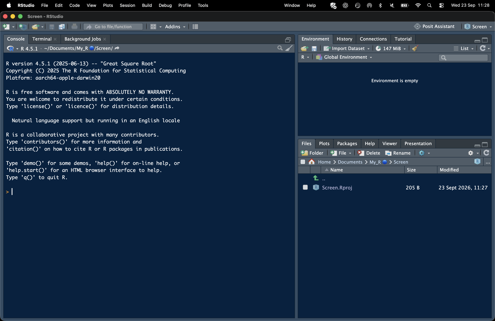
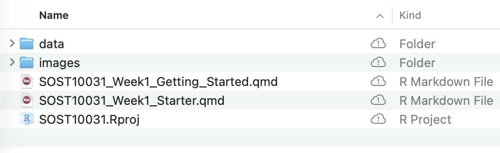
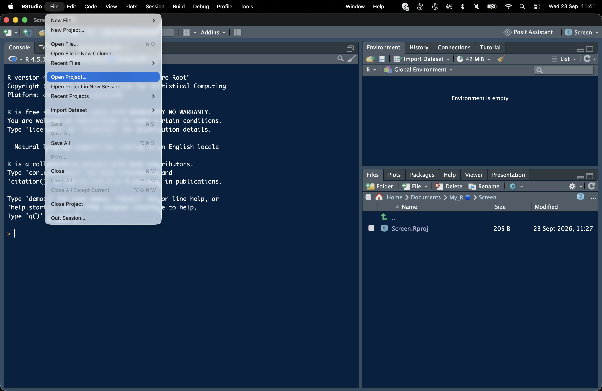
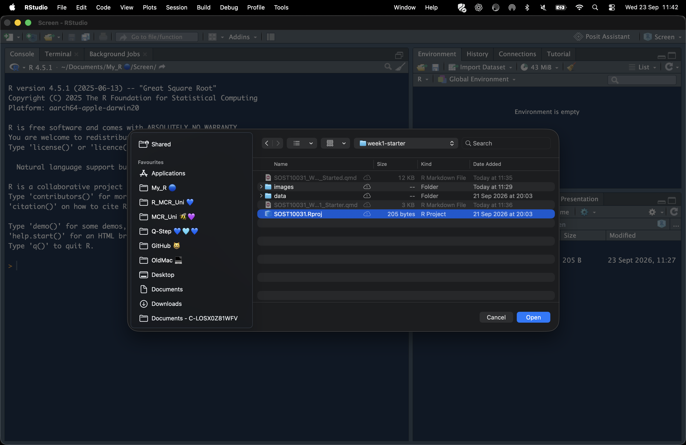
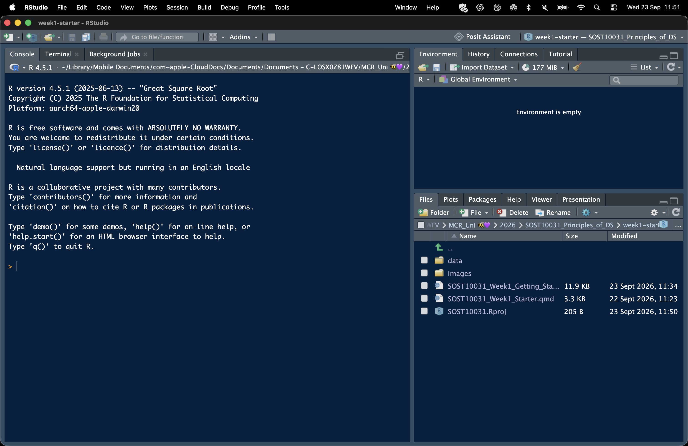
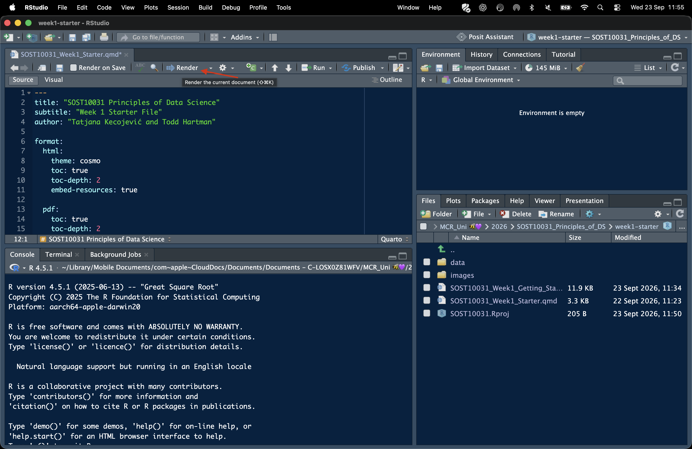
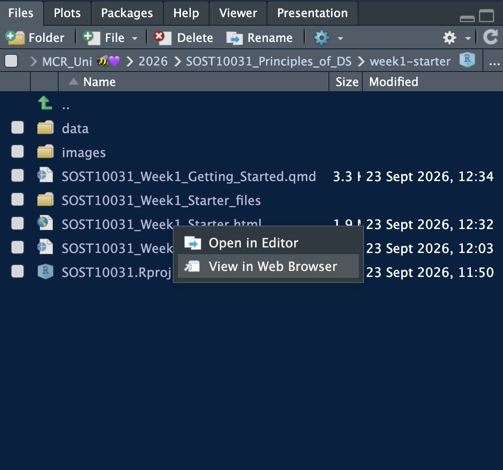

## Who this guide is for

This guide assumes you have never used [R](https://www.r-project.org/), [RStudio](https://posit.co/downloads), [Quarto](https://quarto.org/), or anything like them before. It does not assume you have programmed in any language. Every new term is explained the first time it appears. Take it step by step; you do not need to finish everything in one sitting.

## Your Week 1 task

Please complete this activity **before your second seminar**:

1. Install R and RStudio.
2. Download and unzip the starter folder from Canvas.
3. Open `SOST10031.Rproj`.
4. Open `SOST10031_Week1_Starter.qmd`.
5. Select **Render**.
6. Check that the finished HTML document displays a row count, a small table containing the first few countries and a histogram of female labour force participation.

You do not need to write or change any R code. The purpose of this activity is to check that you can open the supplied project and render a reproducible Quarto document.

You do not need to complete this task before your first seminar. Please complete it before your **second seminar**. If you encounter a problem, keep a copy or screenshot of the error message so that we can help.

## Three names, three jobs

It is easy to confuse R, RStudio and Quarto when you first meet them, so here is how they fit together before we install anything.

**R** is the programming language itself. It is the part that actually does calculations and works with data. On its own, R has a very plain, bare-bones window; almost nobody works directly in that window day to day.

**RStudio** is an application that gives you a friendlier place to work with R: a window with panels for writing code, seeing results, browsing files and viewing help pages, all in one place. RStudio does not replace R; it needs R to be installed first, and gives you a comfortable way to use it. Think of **R as the aeroplane** that does the work, and **RStudio as the airport** that provides an organised place for it to operate.

**Quarto** is a tool for writing documents that mix ordinary text with R code and its results, so that explanations, code, tables and charts all live in one file. This guide, and the file you will run today, are both Quarto documents. RStudio understands Quarto files and gives you a button to turn them into a finished HTML page, which is called **rendering**.

You need all three: R to do the work, RStudio to give you a place to work, and Quarto to combine writing and code in one document.

## Installing the software

You will need **R** and **RStudio Desktop**. Both are free. Install R first, followed by RStudio.

::: {.callout-warning}
## Install the software in this order

Install **R first** and **RStudio Desktop second**.

RStudio needs R to be installed before it can work. Do not open RStudio until both installations are complete.
:::

### Step 1: Install R

* **Windows:** go to [Download R for Windows](https://cran.r-project.org/bin/windows/base/) and select the installer link near the top of the page. Open the downloaded file and follow the instructions, keeping the default options.

* **macOS:** go to [Download R for macOS](https://cran.r-project.org/bin/macosx/) and download the `.pkg` file that matches your Mac. The page explains how to check whether your Mac has an Apple or Intel processor. Open the downloaded file and follow the instructions.

### Step 2: Install RStudio Desktop

Go to the [RStudio Desktop download page](https://posit.co/download/rstudio-desktop/). The page should identify your operating system and offer the appropriate installer.

Open the downloaded file and follow the instructions.

::: {.callout-note}
## What about Quarto?

Quarto works with RStudio to turn a `.qmd` source file into a finished document. Current versions of RStudio provide built-in support for working with Quarto.

You will check that Quarto is working by rendering the supplied starter file. If the **Render** button is unavailable or the file does not render, consult the troubleshooting section below.
:::

::: {.callout-note}
## Software versions

The download pages provide the current versions of R and RStudio. They may look slightly different from versions shown in teaching demonstrations, but the main steps will be the same.
:::

### Checking that R and RStudio are working

Open **RStudio**, rather than R on its own.

Find the panel labelled **Console**. Near the top, you should see a message containing an R version number, such as `R version 4.x.x`.

If you can see this message, RStudio has found R and both are working. You will check Quarto by rendering the supplied starter file later in this guide.

{fig-alt="The RStudio window with the Console panel and R version number highlighted." width="85%"}

## Getting the course files

### Downloading and unzipping the starter folder

Your tutor will make a starter folder available on Canvas, usually as a single compressed file ending in `.zip`. Download it to a location you can find again, such as your Desktop or a folder for this course.

A `.zip` file is a folder that has been compressed into a single file to make it easier to download. You need to **unzip** it (sometimes called **extracting** it) before you can use the files inside.

* **Windows:** right click the downloaded `.zip` file and choose **Extract All…**, then choose a location and select **Extract**.
* **macOS:** double click the downloaded `.zip` file. A new, uncompressed folder with the same name will appear next to it.

Once unzipped, you should have a folder (for this first week, called something like `week1-starter`) containing an `.Rproj` file, one or more `.qmd` files, and a `data` folder.

### Recognising the folder structure

Open the unzipped folder and you should see something like this:

```
week1-starter/
    SOST10031.Rproj
    SOST10031_Week1_Getting_Started.qmd
    SOST10031_Week1_Starter.qmd
    data/
        gii_2023_teaching.csv
    images/
        rstudio-console.png
```

The folder should look similar to this:

{fig-alt="The Week 1 starter folder showing the data folder, images folder, Getting Started Quarto file, Starter Quarto file and SOST10031 RStudio project file." width="75%"}

::: {.callout-important}
## Do not rearrange these files

Leave the files and folders in their original locations. Moving or renaming the `data` or `images` folders, or the files inside them, may prevent the supplied documents from finding what they need.
:::


- **`SOST10031.Rproj`** is a **project file**. It tells RStudio "everything related to this piece of work lives in this folder." Opening this file, rather than opening RStudio and then hunting for other files separately, is the single most important habit to build early: it means RStudio always knows where to look for your files.
- **`.qmd` files** are Quarto documents: the files where text and R code live together. This guide is one of them.
- **The `data` folder** holds the data files used by the code. Keeping data in its own folder, alongside the code that uses it, is standard practice and is what makes the next section work.
- **The `images` folder** holds screenshots and other images used in the Quarto documents. Keeping them inside the project allows the documents to find and display them on another computer.

::: {.callout-note}
## Your folder may look slightly different

The icons and symbols depend on your computer and where you saved the folder. What matters is that the same files and folders are present.
:::

## Opening the project

Open RStudio. From the menu at the top of the screen, select **File**, followed by **Open Project…**

{fig-alt="The RStudio File menu with Open Project highlighted." width="85%"}

Browse to your unzipped `week1-starter` folder. Select **`SOST10031.Rproj`**, followed by **Open**.

{fig-alt="A file selection window showing SOST10031.Rproj selected inside the Week 1 starter folder." width="85%"}

RStudio will reopen with the course project active. You should see the project name in the upper-right corner of the RStudio window.

{fig-alt="RStudio with the Week 1 project open. The project name is visible in the upper-right corner and the Files panel contains the data folder, images folder, two Quarto documents and the RStudio project file." width="95%"}

If you can see the project name in the upper-right corner and the supplied files in the **Files** panel, you have opened the project successfully.

::: {.callout-note}
## Your screen may look different

These screenshots were taken on a Mac. The file window will look slightly different on Windows, but the steps and the name of the project file are the same.
:::

Opening the `.Rproj` file tells RStudio that everything needed for this piece of work is contained in the project folder. It also sets the project folder as the **working directory**, which is the place R treats as its starting point when looking for files.
Opening `SOST10031.Rproj` helps RStudio find all the files used in the course activity, including the dataset in the `data` folder and the screenshots in the `images` folder.

Each time you work on the activity, begin by opening `SOST10031.Rproj`. This allows the supplied Quarto document to work in the same way on different computers and helps make the analysis reproducible.

## Opening and running your first file

In the **Files** panel, select **`SOST10031_Week1_Starter.qmd`**. The file will open in the editor panel on the left.

You will see ordinary text together with sections containing R code. This is normal for a Quarto document.

{fig-alt="RStudio showing the Week 1 Starter Quarto document open in the editor. The Render button appears in the toolbar above the document." width="95%"}

### Rendering the file

Find the **Render** button above the document and select it.

RStudio will:

1. Read the Quarto document from top to bottom.
2. Run the supplied R code.
3. Add the results to the surrounding text.
4. Create a finished HTML page.

This process is called **rendering**. You may see messages appear in a panel while the file is being rendered. This is expected, and the process should take only a few seconds.

When rendering finishes, a new file named **`SOST10031_Week1_Starter.html`** will appear in the project folder. This is the finished document that you can open in a web browser.

RStudio may also create a folder named **`SOST10031_Week1_Starter_files`**. This contains supporting files used to produce the finished document. Leave this folder in place; you do not need to open or edit anything inside it.

::: {.callout-important}
## You do not need to change the code

For this first activity, simply open the supplied file and select **Render**. You are not expected to write or change any R code.
:::
### Opening the finished document

Once rendering finishes, the completed document should open automatically. A new file named **`SOST10031_Week1_Starter.html`** will also appear in the **Files** panel.

To open it again later, select **`SOST10031_Week1_Starter.html`** in the Files panel and choose **View in Web Browser**.

{fig-alt="The RStudio Files panel showing the rendered HTML file and the option View in Web Browser." width="65%"}

Choose **View in Web Browser**, rather than **Open in Editor**. The editor option displays the underlying HTML file and is not needed for this activity.

::: {.callout-note}
## Source file and finished document

The `.qmd` file is the source document containing the text and R code. The `.html` file is the finished document created when you render it.

Work with the `.qmd` file. Do not edit the `.html` file directly.
:::

### Recognising a successful render

You have succeeded if:

* the Render process finishes without stopping partway through, and
* the page that appears shows your text, a small table, and a chart, in the order they appear in the `.qmd` file, and
* there is no red error text in the panel where the rendering activity was shown.

If any of these did not happen, do not worry: the next section covers what to do.

## Troubleshooting

If the file does not render, read the complete error message and try selecting **Render** once more. Check that you opened `SOST10031.Rproj` and that you have not moved or renamed any supplied files or folders.

### The Render button is greyed out or missing

Make sure that `SOST10031_Week1_Starter.qmd` is open and selected in the editor.

If the Render button is still unavailable, close RStudio, reopen `SOST10031.Rproj` and open the starter file again. If this does not solve the problem, ask for help.

### An error says that a file does not exist or cannot be found

Check that the project still has the structure shown earlier in this guide. In particular, confirm that:

* `gii_2023_teaching.csv` is inside the `data` folder
* neither the data file nor the `data` folder has been renamed
* you opened the project using `SOST10031.Rproj`

### An error says that a package is missing

A **package** adds extra tools to R. The Week 1 starter file uses only tools already included with R, so you should not need to install a package for this activity.

If you see a package error, keep a copy of the complete message and ask for help. Later in the course, when an additional package is required, you will receive separate installation instructions.

### Rendering takes a long time

The first render may be slower than later renders. Allow it a little time to finish.

If it has not finished after several minutes, close RStudio, reopen `SOST10031.Rproj` and try again.

### The table or chart looks slightly different

Small differences in appearance between computers and software versions are normal. What matters is that the finished document displays a row count, a small table and a histogram without an error stopping the process.

## Getting help

If the problem continues, ask for help rather than spending a long time stuck on your own. You can ask in a seminar, during office hours or through the course Canvas discussion board.

When asking for help, include:

1. **The complete error message**, copied as text where possible or shown in a clear screenshot.
2. **The name of the file** you were using, such as `SOST10031_Week1_Starter.qmd`.
3. **What you were doing** when the problem appeared, such as selecting Render or opening the project.
4. **Your operating system**, such as Windows or macOS.

Explaining what you tried, what happened and where you became stuck will help us identify the problem more quickly. This is also a useful habit when working with data: keep a clear record of what you did and what you observed.
